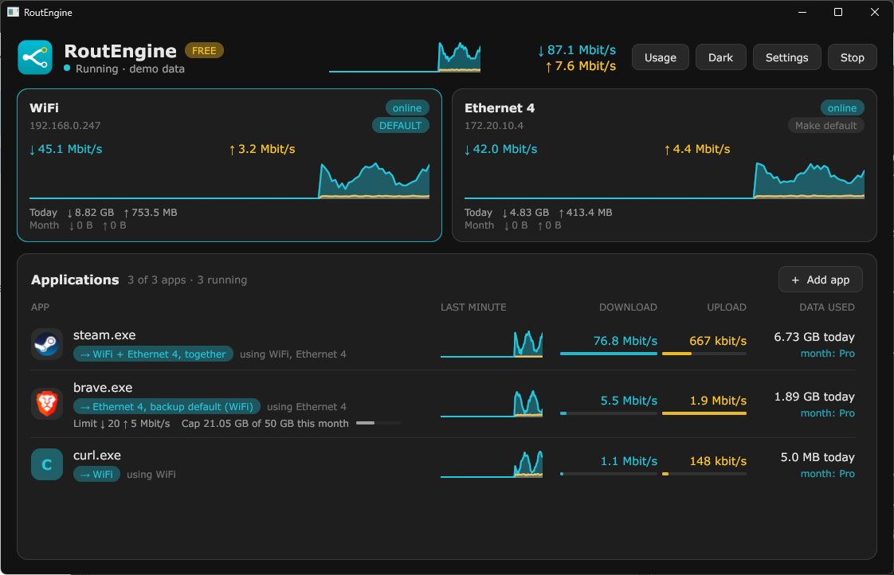
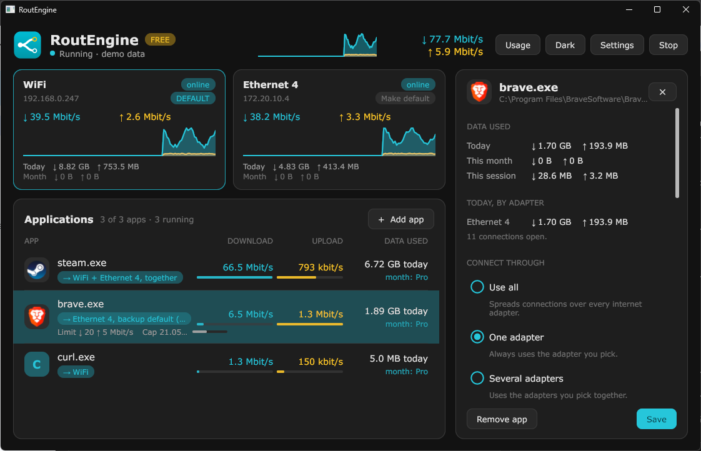

  

# RoutEngine

**Bind every app to an adapter, a speed limit, a data cap.**

RoutEngine is a Windows app that decides which network connection each of your apps uses. Send your browser over Ethernet, your downloads over a phone tether, your work app through a VPN. Combine connections for speed, fall back when one drops, and set a speed limit or a data cap per app.

It is not a VPN. It does not encrypt or hide your traffic. It only chooses which of your own connections an app uses.

[Download](https://routengine.net) · [Docs](docs/README.md) · [Report a problem](../../issues/new/choose) · [Changelog](CHANGELOG.md)

> This repository is the public home of RoutEngine: documentation, release notes and the issue tracker. The program itself is closed source and is distributed from [routengine.net](https://routengine.net).

## What it does

- **Pick the adapter for each app.** Wi-Fi, Ethernet, a phone tether, a VPN or Tailscale. Only the apps you add are moved. Everything else keeps Windows' own choice.
- **Fail over.** If an app's adapter goes down, its connections move to your default adapter or to a list you choose, in order.
- **Combine adapters for speed.** Each new connection goes to the least busy adapter you chose, so browsers, download managers and cloud uploads add the speeds together.
- **Speed limit and data cap per app.** Set a download and upload limit, or a monthly or daily cap. You are warned at 80%.
- **See what uses your network.** Live speed per adapter and per app, today's data, and a usage page for every app that touched the network.
- **Clean exit.** Quit, and the virtual adapter and its routes are removed at once. Windows routing is back to normal.

  

## Requirements

- 64-bit Windows 10 (version 1809 or later) or Windows 11.
- Administrator rights. RoutEngine creates a virtual network adapter to steer traffic, and Windows allows that only with administrator rights. It asks once, at start.

## Quick start

1. Download the installer from [routengine.net](https://routengine.net) and run it.
2. Open RoutEngine and press **Add app**. Pick the program you want to move.
3. Choose its connection: one adapter, several together, or use all. Add a fallback if you want one.
4. Press **Start**. Live speeds appear for each app.

More detail is in [Getting started](docs/getting-started.md).

## Free and Pro

|                                   | Free                          | Pro                    |
| --------------------------------- | ----------------------------- | ---------------------- |
| Use                               | Personal, non-commercial      | Work and business too  |
| Apps                              | Up to 3                       | Unlimited              |
| Per-app routing and fallback      | Yes                           | Yes                    |
| VPN and Tailscale adapters        | Yes                           | Yes                    |
| Combine adapters for speed        | Yes                           | Yes                    |
| Live speeds and today's data      | Yes                           | Yes                    |
| Speed limit                       | On one app                    | On every app           |
| Data cap                          | On one app                    | On every app           |
| DNS per app                       | No                            | Yes                    |
| Fastest-adapter routing           | No                            | Yes                    |
| Usage history beyond today        | No                            | Yes                    |

Pro is ₹1,199 per PC per year, or ₹2,499 once for every 1.x version. Prices are in Indian rupees. Bulk keys are available for many PCs. Current prices are always on [routengine.net](https://routengine.net).

### How to buy

1. Open **Settings** in RoutEngine and press **Copy** next to **This PC**. That is your machine code.
2. Email **sales@routengine.net** with the plan you want and your machine code.
3. We reply with how to pay. After you pay, send us a screenshot of the payment.
4. We check it and email your license key within 24 hours, usually sooner.
5. Paste the key into **Settings**, under **License key**, and press **Activate**.

Details, including moving a license to a new PC, are in [License](docs/license.md).

## Documentation

| Page | What is in it |
| ---- | ------------- |
| [Getting started](docs/getting-started.md) | Install, add an app, start and stop |
| [Routing](docs/routing.md) | Use all, one adapter, several adapters, fallback, VPN |
| [Limits and caps](docs/limits-and-caps.md) | Speed limits, data caps, usage history |
| [License](docs/license.md) | Free and Pro, machine code, the weekly check, moving PCs |
| [Privacy](docs/privacy.md) | What is sent, when, and how to turn it off |
| [Command line](docs/cli.md) | `RoutEngine.exe` commands |
| [Troubleshooting](docs/troubleshooting.md) | Common problems, messages and where the log is |

## Report a problem or ask for a feature

This repository's [Issues](../../issues) are how RoutEngine problems and requests are tracked.

- **Found a bug?** [Open a bug report](../../issues/new?template=bug_report.yml). The form asks for your version and Windows version, and what you expected.
- **Want something added?** [Open a feature request](../../issues/new?template=feature_request.yml).
- **Question about buying or your license?** Email sales@routengine.net. Do not post license keys or machine codes in public issues.
- **Security problem?** Read [SECURITY.md](SECURITY.md). Do not use a public issue.

Please search the open issues first. Add a screenshot when it helps, and check that it shows nothing private.

## Privacy

The free edition sends no data about you. A Pro license is checked online about once a day and must be verified at least once a week. Usage statistics are off unless you turn them on, and are anonymous. Full details are in [Privacy](docs/privacy.md).

## License

RoutEngine the program is licensed under its [end-user license agreement](https://routengine.net/eula.txt). The documentation, screenshots and other files in this repository are copyright RoutEngine, all rights reserved, except that you may quote and link to them when writing about RoutEngine. See [LICENSE](LICENSE).
