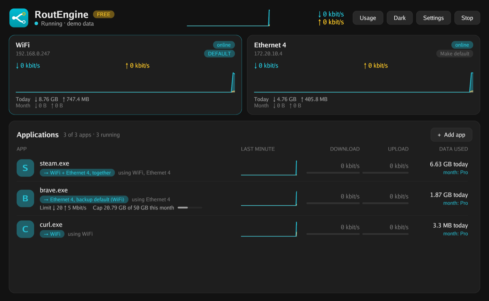
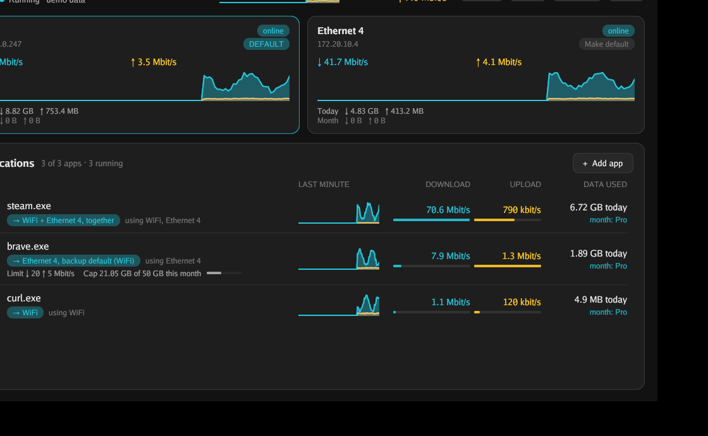

<p align="center">
  
</p>

<h1 align="center">RoutEngine</h1>

<p align="center">
  <strong>Bind every app to an adapter, a speed limit, a data cap.</strong><br>
  Choose which network connection each app uses: Wi-Fi, Ethernet, a phone tether or a VPN. Fail over when a link drops, combine links for speed, and limit speed or data per app.
</p>

<p align="center">
  <a href="https://routengine.net/#download">Download</a> ·
  <a href="#install">Install</a> ·
  <a href="#command-line">Command line</a> ·
  <a href="#free-and-pro">Free and Pro</a> ·
  <a href="docs/README.md">Docs</a> ·
  <a href="../../issues/new/choose">Report a problem</a>
</p>

<p align="center">
  <a href="https://github.com/champdev-me/routengine/releases/latest"></a>
  <a href="https://github.com/champdev-me/routengine/releases"></a>
  
  
  <a href="LICENSE"></a>
  <a href="https://github.com/champdev-me/routengine/actions/workflows/ci.yml"></a>
</p>

<p align="center">
  
</p>

RoutEngine decides which of your connections each app uses. Send your browser over Ethernet, your downloads over a phone tether, your work app through a VPN. It runs on **Windows, macOS and Linux**, and there is a **command-line version** for servers and terminals. It is free for personal use.

It is not a VPN. It does not encrypt or hide your traffic. It only chooses which of your own connections an app uses.

**Press Start and it works.** You do not have to add an app first: every app's new connections are shared across your adapters. Add an app when you want it to have its own rule, a speed limit or a data cap. Press Stop, or quit, and everything returns to the system's own routing at once.

| Windows | macOS | Linux |
|---|---|---|
|  |  |  |

## What it does

- **Pick the adapter for each app.** Wi-Fi, Ethernet, a phone tether, a VPN or Tailscale.
- **Fail over.** If an app's adapter goes down, its connections move to your default adapter or to a list you choose, in order.
- **Combine adapters for speed.** Each new connection goes to the least busy adapter you chose, so browsers, download managers and cloud uploads add the speeds together.
- **Speed limit and data cap per app.** A download and upload limit, or a monthly or daily cap. You are warned at 80%.
- **See what uses your network.** Live speed per adapter and per app, today's data, and a usage page for every app that touched the network.
- **Clean exit.** The virtual adapter and its routes are removed when you quit. Nothing is left behind.

<p align="center">
  
</p>

## Install

**macOS and Linux**: paste this into a terminal. It installs the command-line program.

```
curl -fsSL https://routengine.net/install.sh | sh
```

**macOS app** (window and menu-bar icon): paste this into a terminal.

```
curl -fsSL https://routengine.net/install.sh | sh -s -- --app
```

Or download the `.dmg` from the [latest release](https://github.com/champdev-me/routengine/releases/latest). The app is not notarized by Apple, so the first time right-click it in Applications and choose **Open**.

**Linux app** (window and tray icon): download the `routengine-desktop` `.deb` or `.rpm` from the [latest release](https://github.com/champdev-me/routengine/releases/latest), then:

```
sudo apt install ./routengine-desktop_*.deb      # Debian, Ubuntu
sudo dnf install ./routengine-desktop-*.rpm      # Fedora
```

**Windows**: download the installer from [routengine.net](https://routengine.net). Windows 10 (1809 or later) or 11, 64-bit.

Routing needs administrator rights, because RoutEngine creates a virtual network adapter. Windows and macOS ask once at start. On Linux the package gives the program the network capability, so the window runs as you.

## Command line

The same engine, with no window and no desktop libraries. It runs on a bare Linux server.

```
routengine machine-code            # the code to send when you buy Pro
routengine license add <key>       # activate (the free edition needs no key)
sudo routengine install            # Linux: a systemd service that starts at boot
routengine status                  # on, off, list, quit work too
```

Rules go in `/etc/routengine/config.json` (`~/.config/routengine/config.json` when you are not root):

```json
{
  "rules": [
    { "exe": "qbittorrent", "adapter": "eth1", "failover": ["default"] },
    { "exe": "curl", "balance": ["eth0", "wlan0"] }
  ]
}
```

On macOS a name ending in `.app` covers everything inside that app, so a browser's helper processes follow it. Full list of commands and options: [Command line](docs/cli.md).

## Free and Pro

|                                   | Free                          | Pro                    |
| --------------------------------- | ----------------------------- | ---------------------- |
| Use                               | Personal, non-commercial      | Work and business too  |
| Apps                              | Up to 3                       | Unlimited              |
| Per-app routing and fallback      | Yes                           | Yes                    |
| VPN and Tailscale adapters        | Yes                           | Yes                    |
| Combine adapters for speed        | Yes                           | Yes                    |
| Live speeds and today's data      | Yes                           | Yes                    |
| Speed limit                       | On each of your 3 apps        | On every app           |
| Data cap                          | On each of your 3 apps        | On every app           |
| DNS per app                       | No                            | Yes                    |
| Fastest-adapter routing           | No                            | Yes                    |
| Usage history beyond today        | No                            | Yes                    |

Pro is ₹1,199 per PC per year, or ₹2,499 once for every 1.x version. Prices are in Indian rupees. Bulk keys are available for many PCs. Current prices are always on [routengine.net](https://routengine.net). The window app and the command line use the same license.

### How to buy

1. Open **Settings** in RoutEngine and press **Copy** next to **This PC**, or run `routengine machine-code`. That is your machine code.
2. Email **sales@routengine.net** with the plan you want and your machine code.
3. We reply with how to pay. After you pay, send us a screenshot of the payment.
4. We check it and email your license key within 24 hours, usually sooner.
5. Paste the key into **Settings**, under **License key**, and press **Activate**, or run `routengine license add <key>`.

Details, including moving a license to a new PC, are in [License](docs/license.md).

## Source code

The source of the **command-line program** is in this repository (`cmd/` and `internal/`), under the [PolyForm Noncommercial License 1.0.0](LICENSE): you may read it, build it, change it and use it for noncommercial purposes, such as personal use, hobby projects, research and education. Using it at work or in a business needs a Pro license. This is source-available, not an OSI open-source license. The window apps are closed source.

```
git clone https://github.com/champdev-me/routengine && cd routengine
go build -tags nogui -o routengine ./cmd/routengine     # Linux and macOS; CGO_ENABLED=0 gives a static program on Linux
```

Official downloads are registered with the licensing server. A program you build yourself is not, so a Pro key will not work with it: use your own build with the free edition.

## Documentation

| Page | What is in it |
| ---- | ------------- |
| [Getting started](docs/getting-started.md) | Install, add an app, start and stop |
| [Routing](docs/routing.md) | Use all, one adapter, several adapters, fallback, VPN |
| [Limits and caps](docs/limits-and-caps.md) | Speed limits, data caps, usage history |
| [License](docs/license.md) | Free and Pro, machine code, the weekly check, moving PCs |
| [Privacy](docs/privacy.md) | What is sent, when, and how to turn it off |
| [Command line](docs/cli.md) | Commands on Windows, macOS and Linux, `config.json`, the service, building from source |
| [Troubleshooting](docs/troubleshooting.md) | Common problems, messages and where the log is |

## Report a problem or ask for a feature

This repository's [Issues](../../issues) are how RoutEngine problems and requests are tracked.

- **Found a bug?** [Open a bug report](../../issues/new?template=bug_report.yml). The form asks for your version and system, and what you expected.
- **Want something added?** [Open a feature request](../../issues/new?template=feature_request.yml).
- **Question about buying or your license?** Email sales@routengine.net. Do not post license keys or machine codes in public issues.
- **Security problem?** Read [SECURITY.md](SECURITY.md). Do not use a public issue.

## Privacy

The free edition sends no data about you. A Pro license is checked online about once a day and must be verified at least once a week. Usage statistics are off unless you turn them on, and are anonymous. Full details are in [Privacy](docs/privacy.md).

## License

- The command-line source code in this repository: [PolyForm Noncommercial 1.0.0](LICENSE). Third-party components are listed in [THIRD-PARTY-NOTICES.md](THIRD-PARTY-NOTICES.md).
- The programs you download from routengine.net (the window apps and the command-line build): the [end-user license agreement](https://routengine.net/eula.txt). The window apps are closed source.
- The documentation and screenshots: copyright RoutEngine, all rights reserved, except that you may quote and link to them when writing about RoutEngine.

<p align="center">
  <sub>Want something free and open source? <a href="https://github.com/rohit267/net-merge"><strong>net-merge</strong></a> combines all your connections into one. Same developer.</sub>
</p>
