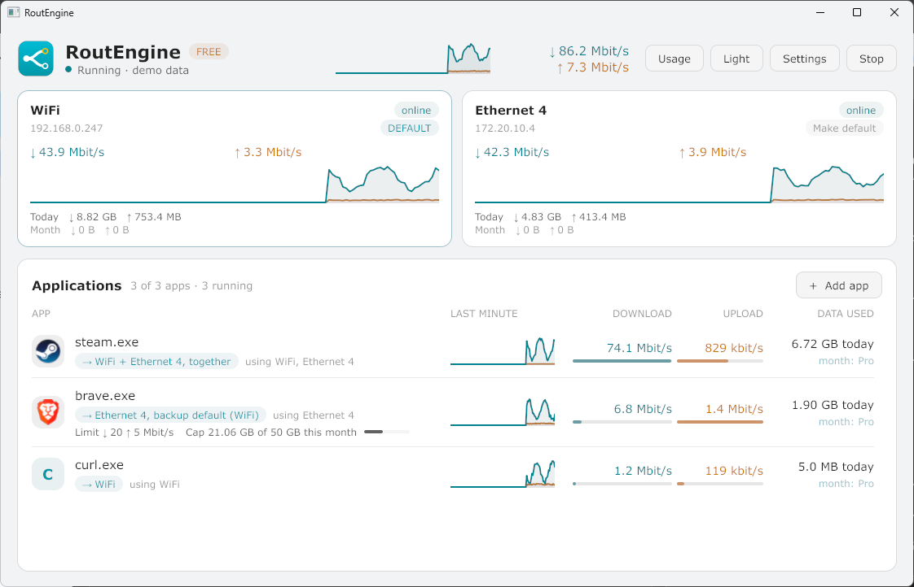

# Getting started

About five minutes.

## 1. Install

**Windows**

1. Download `RoutEngine-setup-<version>.exe` from [routengine.net](https://routengine.net).
2. Run it. Windows may show a SmartScreen warning, see [Troubleshooting](troubleshooting.md#windows-says-the-publisher-is-unknown).
3. Open RoutEngine from the Start menu. Windows asks for administrator rights once. Say yes: RoutEngine needs them to create the virtual adapter that steers traffic.

You need 64-bit Windows 10 (version 1809 or later) or Windows 11.

**macOS** (12 or later, Apple Silicon or Intel)

1. Download the `.dmg` from [routengine.net](https://routengine.net) and drag RoutEngine to Applications. Or paste `curl -fsSL https://routengine.net/install.sh | sh -s -- --app` into a terminal.
2. The first time, right-click RoutEngine and choose **Open** (see [Troubleshooting](troubleshooting.md#macos-says-it-cannot-verify-routengine)).
3. Open it. It asks for your password once, to create the virtual adapter. Its icon appears in the menu bar.

**Linux** (x86-64 or ARM64)

1. Download the `routengine-desktop` `.deb` or `.rpm` (ARM64 now, x86-64 soon) from [routengine.net](https://routengine.net) and install it, for example `sudo apt install ./routengine-desktop_*.deb`.
2. Open RoutEngine from your applications menu. The package already gave it the network capability, so it runs as you and asks for nothing.

On a server with no screen use the [command line](cli.md) instead.

## 2. Add an app

1. Press **Add app**.
2. Pick the program, for example your browser or a game launcher.
3. RoutEngine adds it to the **Applications** list.

The top of the window shows each network adapter with its live speed and the data it moved today. The **Applications** list shows each app you added, how it is routed, its speed and its data.

## 3. Choose its connection

Click an app to open its panel.

Under **Connect through** choose one of:

- **Use all**: connections are spread over every internet adapter.
- **One adapter**: always the adapter you pick. You can add a fallback for when it goes down.
- **Several adapters**: the adapters you tick are used together.

Press **Save**. [Routing](routing.md) explains each mode and fallback.

## 4. Press Start

Press **Start** at the top right. The status line says **Running**, and live speeds appear for each app. The button becomes **Stop**.

You can press Start with an empty list: every app's new connections are shared across your adapters. Apps you add follow their own rule. Stop, or quit, returns everything to the system's own choice.

## 5. Stop and quit

- **Stop** ends routing.
- Closing the window hides it. RoutEngine keeps running in the tray, next to the clock. Click the tray icon to open it again, or use its menu to start, stop or quit.
- **Quit** from the tray menu removes the virtual adapter and its routes. Windows routing returns to normal at once, and nothing is left behind.

## Start with Windows

In **Settings** under **Startup**, tick **Start with Windows** to have RoutEngine start in the tray at sign-in. Routing stays off unless you also tick **Start routing when it opens**.

## Light and dark

The **Dark** / **Light** button at the top switches the theme.

## Next

- [Routing](routing.md)
- [Limits and caps](limits-and-caps.md)
- [License](license.md)
