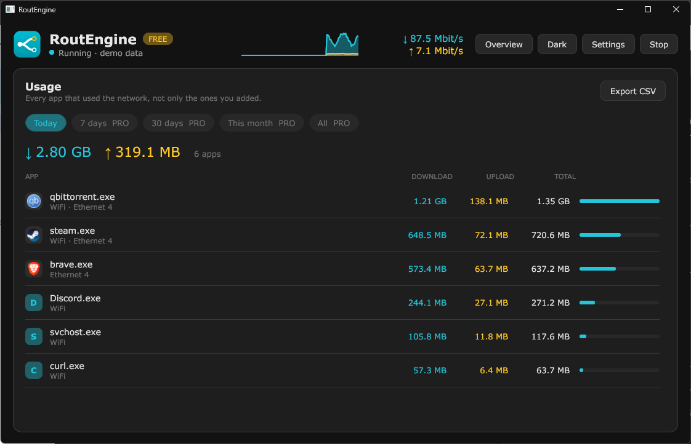

# Limits and caps

## Speed limit

In an app's panel, set a download and an upload limit in Mbit/s. The app is held to those speeds. The apps list shows it, for example `Limit ↓ 20 ↑ 5 Mbit/s`.

## Data cap

Set a number of gigabytes **per month** or **per day**. The list shows how much of it is used, for example `Cap 21.03 GB of 50 GB this month`.

- You are warned at 80%.
- At the cap, the app's connections stop until the period starts again.

## What Free and Pro get

|              | Free       | Pro          |
| ------------ | ---------- | ------------ |
| Speed limit  | Each of your 3 apps | Every app |
| Data cap     | Each of your 3 apps | Every app |

On Free every app in your list of 3 can have a limit and a cap. Pro removes the 3-app limit. See [License](license.md).

## Usage

The **Usage** button shows every app that used the network, not only the ones you added: download, upload and total, and which adapters it used.

- **Today** is available on Free.
- **7 days**, **30 days**, **This month** and **All** are Pro.
- **Export CSV** saves the period shown as a spreadsheet file, one row per day, app and adapter.

Usage is stored on your PC. It is not sent anywhere.
