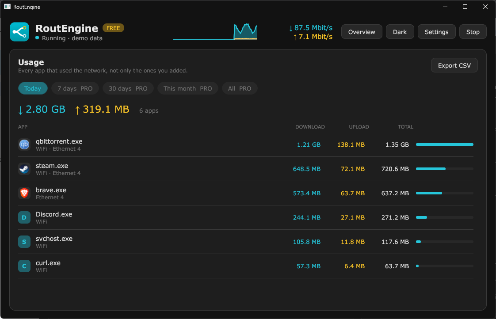

# Limits and caps

## Speed limit

In an app's panel, set a download and an upload limit in Mbit/s. The app is held to those speeds. The apps list shows it, for example `Limit ↓ 20 ↑ 5 Mbit/s`.

## Data cap

Set a number of gigabytes **per month** or **per day**. The list shows how much of it is used, for example `Cap 21.03 GB of 50 GB this month`.

- You are warned at 80%.
- At the cap, the app's connections stop until the period starts again.

## Speed limit per adapter (Pro)

Cap a whole adapter, for example a phone tether, so everything that uses it stays under a speed, for all apps together. Each adapter has a download limit (↓) and an upload limit (↑) in Mbit/s. An empty box means no limit that way, so you can cap only the upload of a tether, for example. The adapter's card shows the limit in force, such as `limit ↓50 ↑10 Mbit/s`.

- **Settings:** under **Speed limit per adapter**, type the limits for each adapter and press **Apply limits**.
- **An app's panel:** **Speed limit per adapter** there caps that one app on each adapter, on top of its own limit and the adapter's limit.
- **From a terminal (window apps):** `RoutEngine.exe limit` lists the limits. `RoutEngine.exe limit "<adapter>" 50` sets 50 Mbit/s both ways, `RoutEngine.exe limit "<adapter>" 50 10` sets 50 down and 10 up, `RoutEngine.exe limit "<adapter>" off 10` limits only the upload, and `RoutEngine.exe limit "<adapter>" off` removes it. Use the adapter's name as `RoutEngine.exe list` shows it. On macOS and Linux the app's program is `routengine`.

In the rules file a limit that is the same both ways is one number, `"adapter_limits_mbit": {"Ethernet": 50}`, and one that differs is `{"Ethernet": {"down": 50, "up": 10}}`.

It needs a Pro license. Without one a limit is kept in your rules file but not applied. The command line does not have it.

## What Free and Pro get

|                          | Free       | Pro          | Command line |
| ------------------------ | ---------- | ------------ | ------------ |
| Speed limit              | Each of your 3 apps | Every app | Every app |
| Data cap                 | Each of your 3 apps | Every app | Every app |
| Speed limit per adapter  | No         | Yes          | No           |

On Free every app in your list of 3 can have a limit and a cap. Pro removes the 3-app limit. The command line has no app limit and no Pro. See [License](license.md).

## Usage

The **Usage** button shows every app that used the network, not only the ones you added: download, upload and total, and which adapters it used.

- **Today** is available on Free.
- **7 days**, **30 days**, **This month** and **All** are Pro.
- **Export CSV** saves the period shown as a spreadsheet file, one row per day, app and adapter.

Usage is stored on your PC. It is not sent anywhere.
